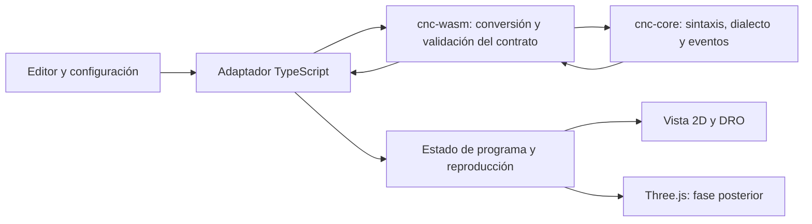

# Arquitectura propuesta — torno educativo X/Z

Estado: dirección revisada y aprobada el 2026-10-20: repositorio independiente. Primera base implementada; ver IMPLEMENTATION_STATUS.md. Los apartados de evolución continúan siendo propuesta. Fecha: 2026-10-20.
Base: PROJECT.md y AGENTS.md del starter; upstream `rudra496/cnc`, commit `b59fefb5043ce53ddd3adf34079398838a69729d`.

## Actualización implementada — 22/10/2026

Tubo y mandrinado longitudinal integrados: ver [TUBULAR_SIMULATION.md](TUBULAR_SIMULATION.md). El parser/intérprete Rust es compartido entre `compile` v1 y el export aditivo `compile_v2`; T5 queda reservado al segundo. Geometría anular independiente, `stock_profile_v3` estricto, material interior separado del programa, proyectos v2 con carga legacy y proyecciones SVG/Three.js sin interpretación CNC. Los sólidos sin T5 conservan la reconstrucción exterior v2. No hay Worker, backend ni reescritura del renderer.

Conjuntos dimensionales educativos compartidos entre SVG/Three implementados; ver TOOL_ASSEMBLIES.md. El motor conserva la punta ideal. TOOL_OFFSETS_PLAN.md propone la separación de referencias para la siguiente frontera; no está implementada.

## Decisión principal

Conservar Next.js/React/TypeScript y los componentes de interfaz que resulten útiles. Incorporar un intérprete de torno nuevo en Rust, independiente del intérprete de fresado existente. El frontend consume bloques y movimientos estructurados; no interpreta semántica CNC. Three.js sigue siendo el motor para la visualización 3D, posterior al recorrido 2D correcto.

La existencia de `lathe_cnc` en `src/lib/cnc/machines.ts` y herramientas `lathe_*` en `tools.ts` no proporciona una simulación de torno: el parser y el heightmap siguen representando fresado. Ver CODE_AUDIT.md.

## ADR-001: origen del proyecto

Decisión del usuario: repositorio independiente con reutilización selectiva. La divergencia prevista y la personalización pesan más que mantener sincronización con upstream. Se inicializó Git localmente en el starter, sin remotes ni fork de GitHub. El clone auditado permanece como referencia externa sin cambios funcionales.

Se reutiliza inicialmente solo el editor. El motor Rust, DTO, stepping y pantalla del laboratorio son nuevos. Evitar copiar el parser, dependencias y configuración de fresado; incorporar otros componentes únicamente cuando ahorren trabajo concreto.

Si se decide extraer componentes, registrar ruta original, SHA, modificaciones y licencia en THIRD_PARTY_NOTICES.md. La [licencia MIT del código auditado](https://github.com/rudra496/cnc/blob/b59fefb5043ce53ddd3adf34079398838a69729d/LICENSE) exige conservar el aviso de copyright y el permiso en copias o partes sustanciales. Una mención informal en el README no reemplaza esos avisos. Mantener crédito a Rudra Sarker y separar la identidad del nuevo producto de los metadatos y analytics del original.

## ADR-002: límites de responsabilidad



Estructura de referencia; la implementación real simplifica módulos inicialmente (ver IMPLEMENTATION_STATUS.md):

```text
Cargo.toml                         # workspace
crates/cnc-core/src/
  lib.rs
  syntax.rs                        # tokens, bloques, spans; sin semántica de fresadora
  dialect.rs                       # reglas y capacidades de edu-lathe-v1
  interpreter.rs                   # transiciones deterministas de estado
  motion.rs                        # trayectorias físicas y vínculo al bloque
  geometry.rs                      # unidades, puntos, tolerancias
crates/cnc-wasm/src/lib.rs          # wasm-bindgen + serialización
src/lib/lathe/engine.ts             # contrato, init asíncrono y errores de carga
src/lib/lathe/store.ts              # revisión del documento, resultado, cursor
src/components/lathe/              # panel, DRO X/Z, trayectoria 2D
fixtures/lathe/                     # fuente, opciones y resultado esperado
```

`cnc-core` no depende de React, DOM, Three.js, reloj, filesystem ni WASM. Puede usar `serde` para DTO; `wasm-bindgen` y conversiones JS quedan exclusivamente en `cnc-wasm`. Módulos dentro de un crate inicialmente: no crear un framework de plugins ni un crate por cada concepto.

Rust produce una secuencia determinista completa para programas cortos. El paso a paso recorre bloques ya interpretados. No cruzar la frontera WASM en cada frame ni mantener dos intérpretes sincronizados. El renderer interpola segmentos para animación; no decide modos, compensaciones o coordenadas finales.

## ADR-003: dialecto mínimo explícito

Nombre provisional: `edu-lathe-v1`, subconjunto educativo inspirado en controles de torno estilo Fanuc. No se declara compatibilidad genérica Fanuc. No hay un manual Fanuc concreto seleccionado en PROJECT.md: eso sigue pendiente antes de agregar semántica específica de un control.

Se documenta este subconjunto propio para evitar bloquear G00/G01 o importar automáticamente G90/G91 de fresadora. La documentación primaria de [Haas G90](https://www.haascnc.com/service/codes-settings.type%3Dgcode.machine%3Dlathe.value%3DG90.html) describe un ciclo de torneado y [Haas G98](https://www.haascnc.com/service/codes-settings.type%3Dgcode.machine%3Dlathe.value%3DG98.html) avance por minuto. Son evidencia de la ambigüedad entre controles, no una certificación de compatibilidad Fanuc.

| Elemento | Regla propuesta para el MVP |
|---|---|
| Unidades | Solo mm; G21 aceptado, G20 rechazado |
| Plano | X/Z; G18 aceptado; G17/G19 y eje Y rechazados |
| X programado | Diámetro, visible como `X Ø mm`; interno: radio físico `r = X / 2` |
| Z | Longitud axial en mm; cero en cara frontal, negativo hacia el plato |
| Coordenadas | X/Z absolutos en el sistema de trabajo fijo; incrementales mediante U/W en el mismo bloque o posteriores |
| U/W | `r_final = r_actual + U/2`, `z_final = z_actual + W`; rechazar X con U o Z con W en el mismo bloque |
| G90/G91 | Error de código no soportado; no usarlos para alternar modos |
| Movimiento | G00/G01 modales; exigir selección explícita de movimiento antes del primer bloque con ejes |
| G00 | Segmento recto simultáneo idealizado, sin afirmar cinemática de un control real |
| Avance | F positivo en mm/min; G98 aceptado como selección explícita de ese único modo; G99/G94/G95 rechazados |
| Husillo | S RPM no negativo, M03/M04/M05; solo estado didáctico; sin CSS ni sincronización física |
| Herramienta | Una herramienta externa genérica seleccionada en UI; T/M06 rechazados inicialmente; no simular T0101 como T101 |
| Fin | M02/M30 terminan; bloque terminal sin ejes; no ejecutar bloques posteriores |
| Otros M | M00/M01/M07–M09 y desconocidos: diagnóstico bloqueante inicialmente |
| Compensaciones y offsets | Origen fijo y herramienta ideal sin offsets; G40/G41/G42/G43/G53–G59/G92 rechazados inicialmente |
| Comentarios | `;` hasta fin de línea y paréntesis no anidados; cierre faltante o anidación: error explícito |
| Identificación | N entero como etiqueta; número de línea física independiente. `%` solo como delimitador en línea propia; O entero opcional como metadato |
| Fuera del subconjunto | G02/G03, ciclos, macros, variables, subprogramas, slash/block-delete y palabras desconocidas: error visible |

Valores iniciales en el contrato: unidades mm, convención diámetro, plano X/Z, posición de trabajo definida por setup; movimiento y F sin definir hasta declararse. Husillo detenido y S=0. El ejemplo usa `r=30,z=5` (DRO X=60,Z=5), stock Ø50 × 100 mm. No autodeducir stock u origen de los bounds del programa.

Permitir Z positivo y negativo; limitar el MVP a X/U que no produzcan radio negativo. No confundir Z negativo con corte: en torno la penetración depende de stock, herramienta y trayectoria. Modo radio queda para una versión posterior del dialecto, con fixtures equivalentes; la conversión nunca depende del zoom ni de la configuración de cámara.

El F no se divide por dos al programar diámetros. Para duración idealizada de G01 usar longitud física `hypot(Δr, Δz) / F * 60`. Sin F modal positivo, G01 es error; no inventar un avance por defecto. La primera entrega puede mostrar solo paso discreto y omitir tiempos estimados.

Lexing completo: consumir toda la entrada; rechazar basura, números no finitos, decimales G no soportados, ejes duplicados, múltiples códigos del mismo grupo y valores incompletos. No redondear G1.4 a G1. Los selectores G/M y etiquetas N/O requieren literales enteros sin punto decimal ni signo, incluso si f64 redondearía el valor a un entero. Validar el bloque antes de aplicar ningún cambio modal.

## ADR-004: contrato Rust ↔ TypeScript

API conceptual v1, no código implementado:

```ts
type Position = { rMm: number; zMm: number };
type SourceSpan = {
  line: number; columnStart: number; columnEnd: number;
}; // base 1, fin exclusivo; columnas UTF-16, incluyendo comentarios Unicode

type CompileRequest = {
  apiVersion: 1;
  dialect: 'edu-lathe-v1';
  sourceRevision: number;
  source: string;
  setup: {
    xConvention: 'diameter';
    initialPosition: Position;
    stock: { diameterMm: number; lengthMm: number };
    toolId: 'generic-od';
  };
};
```

`compile(request)` devuelve `apiVersion`, `sourceRevision`, `dialect`, `executable`, `initialState`, `blocks`, `motions`, `diagnostics`, `finalState`. La fachada TS es `Promise<CompileResult>` aunque la llamada WASM sea síncrona después de inicializar. Versión o dialecto incompatibles son errores del contrato.

- `Block`: `id`, `span`, `source`, `beforeState`, `afterState`, `motionIds`, `kind` (`state`, `motion`, `end`, `comment`). Los bloques vacíos no generan pasos. Comentarios se conservan para explicar pero se omiten al ejecutar; líneas con solo estado sí consumen un paso.
- `Motion`: `id`, `blockId`, `span`, `kind` (`rapid`, `linear`), `from`, `to`, `feedMmMin` (null para rápido), `toolId`. Medidas físicas en radio/mm; el DTO no contiene Vector3 ni colores. Un bloque puede generar varios movimientos en ciclos futuros.
- `State`: posición, modo de movimiento nullable, F nullable, RPM, sentido y encendido del husillo, plano/unidades/convención y herramienta de setup. Solo una fuente de verdad para el estado CNC: snapshots del motor.
- `Diagnostic`: código estable, severidad, span y mensaje; traducción pedagógica por código en UI. Ante error, `executable=false`, `motions=[]`, `finalState=null`; diagnósticos múltiples permitidos. No se reproduce un prefijo parcial. Bloques posteriores al fin se marcan como no ejecutables con aviso si contienen instrucciones.

Serializar inicialmente mediante `serde-wasm-bindgen`, validar forma y números en la entrada Rust y al recibir en TS. Generar o verificar tipos TS mediante fixtures de contrato para impedir drift; la firma `JsValue` por sí sola no garantiza esos tipos. No aceptar NaN/Infinity, stock no positivo ni posiciones iniciales inválidas. Límites propuestos: 256 KiB de fuente y 10.000 bloques/movimientos; excederlos da diagnóstico. Ajustar con mediciones antes de ampliar ciclos.

No exponer handles Rust de sesión inicialmente: un resultado inmutable basta. Futuros ciclos expanden bloques a los mismos eventos. Offsets y compensación podrán distinguir trayectoria programada y trayectoria de punta; reservar esa separación conceptual sin fingir que está implementada.

## ADR-005: reproducción y geometría 2D

Cursor: número de bloques ejecutables ya completados, `0..N`. Antes del primer paso se muestran setup y ninguna línea ejecutada. `stepForward` aplica el siguiente `afterState` y resalta su línea; el último paso alcanza efectivamente el último destino. `stepBackward` restaura el snapshot anterior y reset restaura `initialState`. Las líneas solo S/M/F cambian estado aunque no exista segmento.

Editar o cambiar setup pausa, incrementa `sourceRevision`, invalida el resultado anterior y vuelve al estado inicial. Un resultado con revisión vieja se descarta. Durante compilación/carga/error se deshabilita ejecución. Click para editar no salta automáticamente el estado: usar una acción explícita de ir a bloque.

Vista inicial: SVG ortográfico con Z horizontal creciente a la derecha y radio físico positivo hacia arriba. Etiqueta vertical `X Ø`, ticks en diámetro sobre posiciones `r`; misma escala física por mm para r y Z. Stock ocupa `z ∈ [-100,0]`, `r ∈ [0,25]` en el ejemplo. Mostrar eje central, origen, stock inicial, punta ideal y segmentos independientes; rápidos discontinuos y avances continuos. Se puede reflejar el stock para mostrar su sección completa, sin duplicar el diámetro geométrico. No unir segmentos de avance separados por rápidos.

Elegir SVG para el primer gráfico reduce complejidad, facilita pruebas y evita exigir WebGL para aprender X/Z. Three.js no se elimina del frontend existente; en una fase posterior consume el mismo estado con superficie de revolución. Esta secuencia sigue PROJECT.md: trayectoria correcta antes de superficie 3D.

El contorno de trayectoria no es una pieza mecanizada. Primera entrega: stock inicial y trayectoria superpuesta. Segunda entrega implementada: perfil exterior idealizado mediante intervalos exactos en Rust, restringido y claramente etiquetado; ver STOCK_PROFILE_MODEL.md. No usar directamente el mínimo X visitado como material removido: un tramo de aproximación o retorno no define por sí solo una operación de torneado.

## ADR-006: integración sin regresiones

La aplicación independiente sirve el laboratorio en `/`. No se incorpora la ruta de fresado. El clone original queda separado y no se migra su estado. El editor extraído recibe props y deja de importar Zustand; el store de reproducción inicial es un reducer puro, sin necesitar una dependencia global. El motor tiene su propio contrato X/Z y nunca cae al parser de fresadora si falla WASM.

La primera base usó setup fijo Ø50×100. La iteración de interfaz ya permite editar material y posición inicial, con herramienta ideal y fuente editable. Persistencia y 3D siguen pendientes. Se conserva procedencia exacta del editor en THIRD_PARTY_NOTICES.md, licencia original y copias de avisos en el export estático.

Persistencia v2: clave separada y esquema con machineKind, dialectVersion, stock cilíndrico y setup. Importación explícita por formato; no reinterpretar automáticamente programas de fresadora como torno. Informar fallos de cuota y no afirmar guardado exitoso cuando falla localStorage.

## ADR-007: WASM y despliegue estático

Propuesta de build: Rust target `wasm32-unknown-unknown`, `wasm-pack build crates/cnc-wasm --target web`, assets JS/WASM juntos y con versión/hash en `public/wasm/<version>/`. Inicializar una vez desde el adaptador cliente con URL del binario explícita que respete basePath. El build copia assets antes de `next build`; nunca importar WASM durante SSR ni depender de un backend Rust.

`--target web` permite inicialización explícita en navegador ([documentación wasm-bindgen](https://wasm-bindgen.github.io/wasm-bindgen/reference/deployment.html)). Next admite salida estática mediante `output: 'export'` ([documentación oficial](https://nextjs.org/docs/app/guides/static-exports)). La integración concreta con la versión fijada de Next sigue siendo una hipótesis a validar con una prueba pequeña de carga, MIME `application/wasm`, errores de red y despliegue bajo subruta. `next start` no es el servidor de la salida exportada: servir `out/` con servidor estático.

Fijar versiones de Rust, wasm-pack, gestor JS y lockfile en CI. No depender de `latest`; no ocultar errores nuevos de tipos. No añadir threads WASM, SharedArrayBuffer ni cabeceras COOP/COEP al MVP. Worker después de medir latencia: aporta aislamiento de cómputo, pero complica mensajes, cancelación y URLs. La fachada asíncrona y sourceRevision permiten incorporarlo sin cambiar la UI.

## Evolución prevista

- Arcos: módulo geométrico probado en G18; verificar sentido desde el punto de vista elegido, I/K y diámetro/radio en manual antes de aceptar códigos.
- Ciclos: expansión de un bloque a N movimientos, todos vinculados al bloque fuente, con límites de expansión y cancelación.
- Correcciones: offsets de trabajo, geometría/desgaste y compensación de punta como transformaciones explícitas; no mezclar con dibujo.
- Catálogos: IDs estables, geometría de inserto/portaherramienta/orientación y procedencia/licencia por dataset; no heredar flautas/chip-load de fresado para torno.
- CAM: operaciones → trayectorias/IR → postprocesador del dialecto → mismo intérprete y fixtures. Sin acoplar el núcleo a UI, catálogos externos o cuentas.

La utilidad es educativa; no se presenta la simulación como validación industrial ni como garantía para una máquina real.


## Incremento de vista 3D

La superficie de revolución prevista se implementó como vista opcional y bajo demanda. Consume el mismo StockProfile de Rust que usa SVG. La proyección de malla TS es pura; Three.js solo gestiona cámara, luces y buffers. No cambia el contrato de interpretación ni los límites del perfil. Ver [decisiones y validación](REVOLUTION_3D.md).
